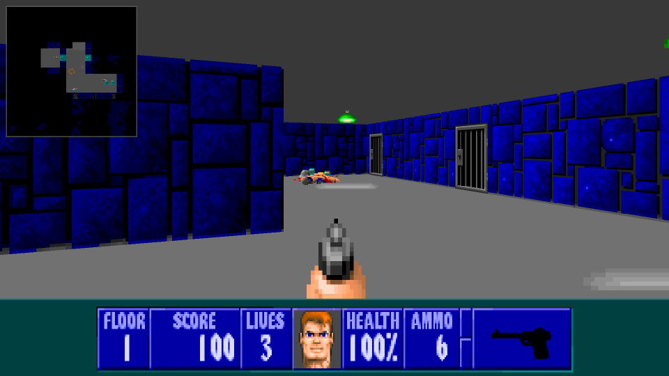

Minimap Branch
==============

Developed with AI assistance (Claude)

- adds an optional minimap to the top left of the view
- with or without frame (floating: only the map itself is darkened)
- adjustable size, zoom and translucency, optionally rotating with the player
- full map, overlay and minimap now each have their own settings (rotate, textured walls, floors, what gets marked)
- configurable markers: enemies (off, in sight, explored, all), objects (explored, all), secret walls, keys, weapons, ammo, health, treasure, extra lives, corpses and decorations
- map reveal cheat: unexplored parts grayed out, as lines, or in full
- explored floors stand out from unexplored and merely revealed areas
- the automap key cycles off → minimap → overlay → full map, skipping disabled ones; an active minimap is remembered
- includes the fix for rays slipping past closed doors at exact tile corners (submitted upstream separately)

ECWolf
======

ECWolf is a port of the Wolfenstein 3D engine based of Wolf4SDL. It combines the original Wolfenstein 3D engine with the user experience of ZDoom to create the most user and mod author friendly Wolf3D source port.

Like ZDoom, ECWolf aims to support all games which use the Wolfenstein 3D engine including Blake Stone (coming in ECWolf 3.0), Corridor 7, Operation Body Count, Rise of the Triad, and Super 3D Noah's Ark.  ECWolf will also support Macintosh Wolfenstein 3D along with all of its user created missions (coming in ECWolf 2.0).

* Single binary runs all supported games.  (Wolfenstein 3D, Spear of Destiny, ...)
* Full support for high resolution modes with aspect ratio correction including wide screen support.
* Modern control schemes (WASD + mouse).
* Mac Wolf/S3DNA/ROTT style automap.
* Unlimited save slots.
* This is actually based on the Wolf3D engine instead of a recreation or forcing into a more modern engine.
    * Software rendered using the same 8-bit ray casting.

Mod authoring
-------------

* Create mods without working with the source code!
    * Mods work with all supported platforms including Windows, Mac OS X, and Linux.
* Arbitrary high resolution texture, flat, and sprite support.
* Unlimited simultaneous moving pushwalls.
* Unlimited things.
* Unrestricted map size. (Although technical limits restrict GAMEMAPS format to 181x181.)
* Uses scripting formats and data formats similar to those of ZDoom.
    * Doom editing utilities work with ECWolf. (Except for levels)

Note that until ECWolf 2.0, while radical changes are not excepted, backwards compatibility for mods will not necessarily be kept.  See [the wiki](http://maniacsvault.net/ecwolf/wiki/Version_compatibility) for more information.

Links
-----

* [Website](http://maniacsvault.net/ecwolf/)
* [Forums](http://forum.drdteam.org/viewforum.php?f=174)
* [Wiki](http://maniacsvault.net/ecwolf/wiki/)